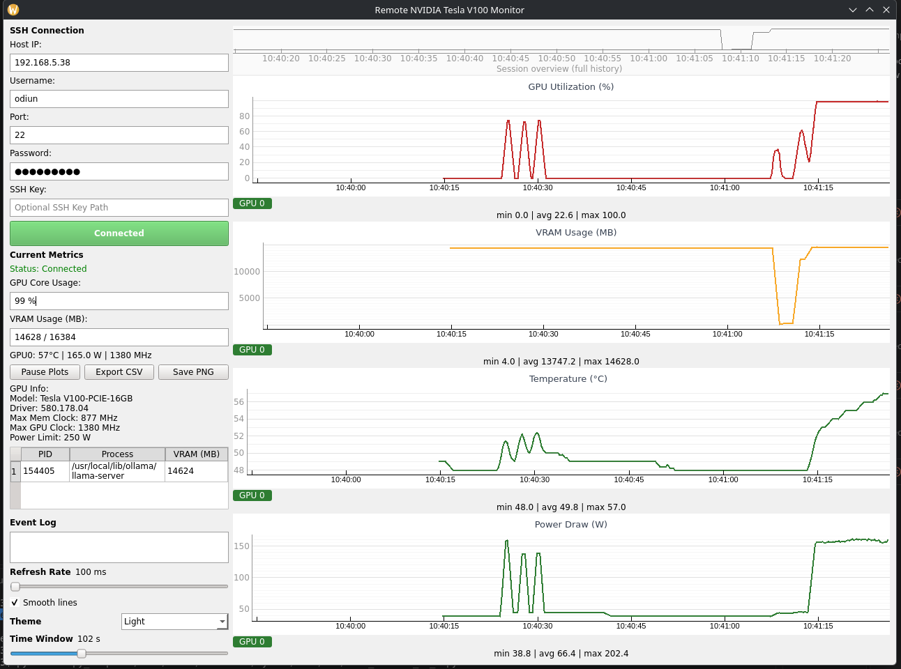

# V100 Monitor

[](https://github.com/Wheelem/V100_Monitor/actions)
[](LICENSE)

The *V100 Monitor* is a lightweight, real‑time dashboard for an NVIDIA Tesla V100 GPU that runs on a remote host.  The application connects via SSH, runs a single `nvidia-smi` round‑trip per refresh, and visualises the following metrics:

- **GPU utilisation (%)**
- **VRAM usage (MB)**
- **Temperature (°C)** – a throttle reference line is shown at **85 °C**.
- **Power draw (W)**

Additionally the GUI displays the current process list, the latest metric values and a small event log that records when a GPU becomes hot or recovers.

The project is written in **Python 3** and relies on the following libraries:

- `PyQt6` – for the GUI
- `pyqtgraph` – for high‑performance plotting
- `paramiko` – for SSH communication
- `numpy` – optional (used only for helper calculations)

---

## Features

| Feature | Description |
|---------|-------------|
| Remote monitoring | Connect to a remote machine via SSH; no software needs to be installed on the host other than the default `nvidia-smi` tool.
| Auto‑reconnect | The background thread automatically reconnects with exponential back‑off when the SSH connection is lost.
| Autoscaling Y‑axis | Each plot automatically scales to the current data range.  Double‑click a plot to pin the Y‑axis.
| Adjustable refresh & window | Use the sliders to change the polling frequency and the time window shown on the x‑axis.
| Smoothing | Optional moving‑average smoothing of the curves.
| Themes | Light and Dark themes that persist between sessions.
| Export | Export the collected history to a CSV file or capture a PNG of all plots.

---

## Usage

```bash
# Install all dependencies from the lockfile
pip install -r requirements.txt

# If you plan to use the optional helper calculations, install numpy as well:
pip install numpy

# Run the monitor
# When inside the GUI folder you can run it directly:
python v100_monitor_V1_0.py
# Or use the full path from the repo root:
python GUI/v100_monitor_V1_0.py
```

When the GUI starts, enter the SSH credentials for the host that has the V100.  Click **Connect to V100** – the dashboard will start polling.

The left sidebar shows the latest values and a table of the top compute processes (sorted by VRAM usage).  The right side contains the four live plots.  Use the sliders to adjust the refresh rate and the time window.

---

## Directory layout

```
GUI/
├── v100_monitor_V1_0.py  # main script (current release)
├── README.md
├── requirements.txt
├── LICENSE
├── .vscode/
│   └── settings.json
└── v100_monitor_wheelem/  # Git submodule containing wheel artifacts
```

---

### VS Code Workspace

The `.vscode/settings.json` file is configured to target the new entry point
(`v100_monitor_V1_0.py`) and uses a Python virtual environment.  If you
open the folder in VS Code, the Python extension will automatically
activate the environment and install the dependencies from
`requirements.txt`.
---

## Contributing

Feel free to submit pull requests.  The code follows a fairly straightforward, self‑contained structure – it is a single module with clear comments and a small set of dependencies.  If you wish to add features or fix bugs, just add a test and push your changes.

---

## License

[MIT](LICENSE) – see the accompanying `LICENSE` file.

---

Happy monitoring!

---

**Disclaimer**: This code was written with assistance from GPT‑Oss (commit 209b). It was generated by an AI language model and may require review and testing before use in production environments.

---

## Troubleshooting

- **`nvidia-smi` not found** – The host machine must have the NVIDIA driver installed and the `nvidia-smi` binary in the PATH. Verify by running `nvidia-smi` from a shell.
- **SSH authentication fails** – Make sure the key file is readable and the user has `PermitRootLogin` or `PubkeyAuthentication` enabled on the server.
- **GUI freezes or crashes** – Check that the system has the required GPU drivers for PyQt6 and that no other heavy processes are consuming CPU or memory.


